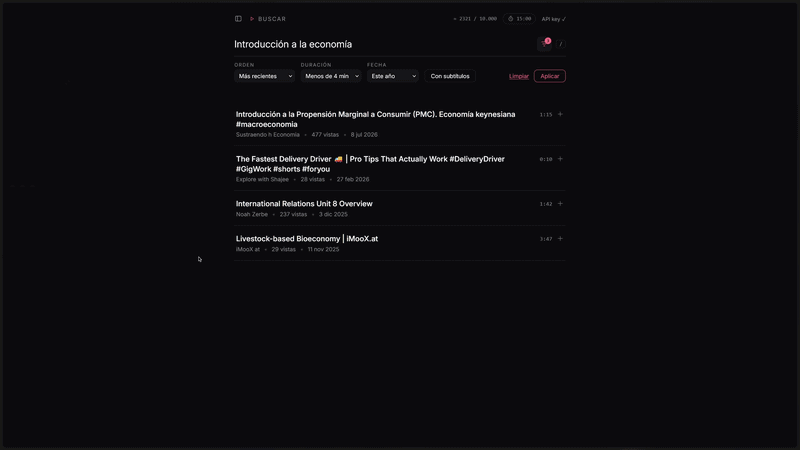
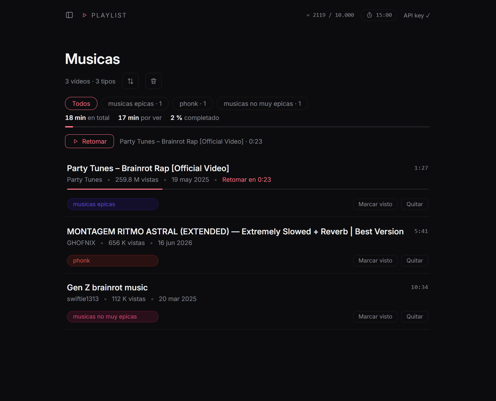
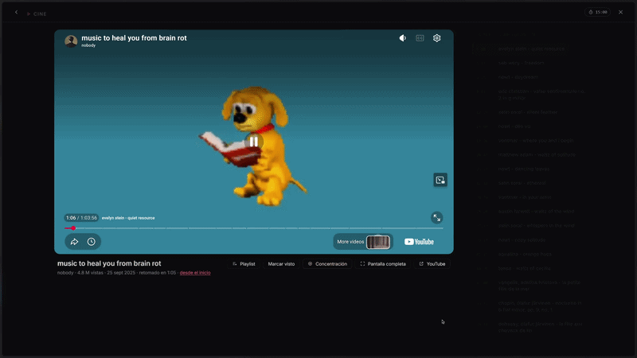
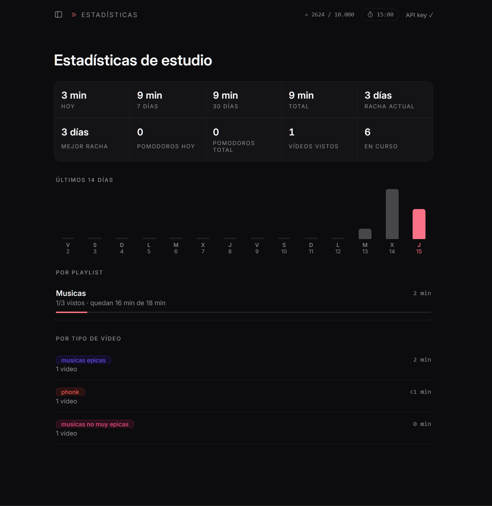
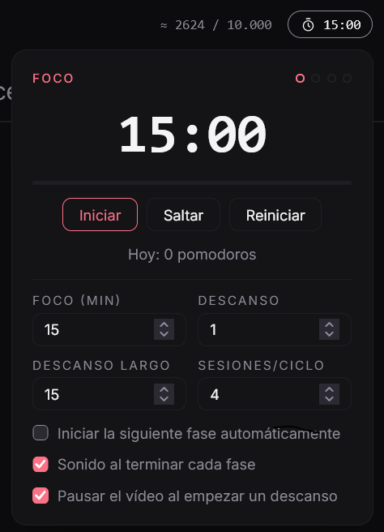
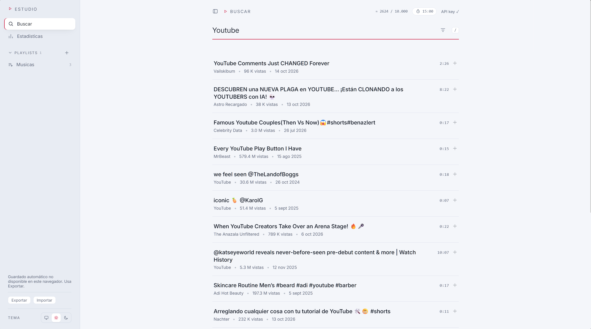
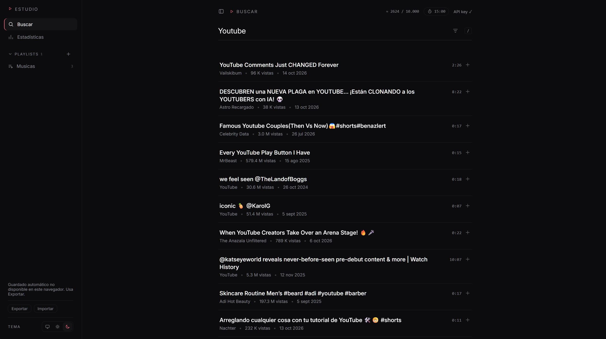
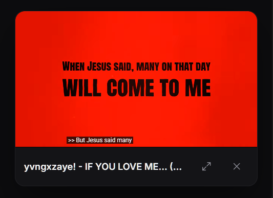

<div align="center">

# yt-minimal

**YouTube minimalista para estudiar.**
Sin miniaturas, sin recomendaciones y sin comentarios: solo tú y lo que quieres aprender.

[](LICENSE)


[**Ver demo**](https://TU-USUARIO.github.io/YT-Minimal/) · [Documentación completa](docs/README.md)


</div>

---

## ¿Qué es?

YouTube está hecho para **retener** tu atención; yt-minimal, para **concentrarla**. Conserva lo útil (buscar, guardar, reproducir y retomar) y quita lo que distrae.

> **Descubrir** → **Guardar** en playlists con un tipo → **Estudiar** → **Medir** el avance.

Es una web **estática** (React por CDN, módulos ES y CSS plano): sin backend, sin cuentas y sin compilar. Usas **tu propia API key gratuita** y tus datos se quedan en tu navegador.

## Características

- 🔎 **Búsqueda solo con texto** (título, canal, vistas, fecha y duración), con filtros y soporte para pegar enlaces de vídeos y playlists.
- 🎬 **Reproductor sin distracciones**: modo cine con cola, modo concentración, mini reproductor flotante y avance automático al siguiente vídeo.
- 📚 **Playlists con tipos de colores** (teoría, práctica, repaso…), duración total, tiempo por ver y botón para **retomar donde lo dejaste**. Sus vídeos se pueden **reordenar** arrastrándolos o con flechas.
- 🧭 **Capítulos** leídos de la descripción del vídeo, para saltar de tema en tema.
- 📊 **Estadísticas**: tiempo estudiado, rachas, gráfico de 14 días y desglose por playlist y tipo.
- 🍅 **Pomodoro integrado** y configurable, que puede pausar el vídeo en los descansos.
- 🌗 **Tema claro, oscuro o del sistema**, sin parpadeo al cargar.
- 💾 **Datos portables**: exportar/importar en JSON y guardado automático en un archivo propio.
- 📱 **Instalable (PWA)** y con uso sin conexión para tus playlists y progreso.

## Capturas

<table>
  <tr>
    <td width="50%"><br><sub><b>Filtros</b> de orden, duración, fecha y subtítulos</sub></td>
    <td width="50%"><br><sub><b>Playlists</b> con tipos y progreso</sub></td>
  </tr>
  <tr>
    <td width="50%"><br><sub><b>Modo cine</b> con la cola de la playlist</sub></td>
    <td width="50%"><br><sub><b>Modo concentración</b> con capítulos</sub></td>
  </tr>
  <tr>
    <td width="50%"><br><sub><b>Estadísticas</b> de estudio</sub></td>
    <td width="50%"><br><sub><b>Pomodoro</b> en la cabecera</sub></td>
  </tr>
  <tr>
    <td width="50%"><br><sub><b>Tema claro</b></sub></td>
    <td width="50%"><br><sub><b>Tema oscuro</b></sub></td>
  </tr>
</table>

<p align="center">
  <br>
  <sub><b>Mini reproductor</b>: el vídeo sigue sonando mientras buscas</sub>
</p>

## Inicio rápido

No hay nada que instalar. Sirve la carpeta con cualquier servidor estático:

```bash
git clone https://github.com/TU-USUARIO/YT-Minimal.git
cd YT-Minimal
python -m http.server 8000
```

Abre <http://localhost:8000>.

> ⚠️ Abrir `index.html` con doble clic no funciona (*error 153* del reproductor): necesita una dirección `http://`.

## API key

Sin clave, la app funciona en **modo demo**. Para resultados reales:

1. Crea un proyecto en [Google Cloud](https://console.cloud.google.com/projectcreate) y habilita **YouTube Data API v3**.
2. Crea una **clave de API** en [Credenciales](https://console.cloud.google.com/apis/credentials).
3. Pégala en el botón **API key** de la cabecera.

La cuota gratuita (10 000 unidades/día) alcanza para unas 99 búsquedas; **ver vídeos no gasta cuota**, y las búsquedas se guardan 24 h. Detalles en la [documentación](docs/README.md#7-api-key-y-cuota).

## Atajos

| Tecla | Acción |
|---|---|
| `/` | Enfocar el buscador |
| `Enter` | Buscar / aplicar filtros |
| `Esc` | Enviar el vídeo al mini reproductor |

## Publicar en GitHub Pages

*Settings → Pages → Deploy from a branch →* rama `main`, carpeta `/ (root)`. Tu app quedará en `https://TU-USUARIO.github.io/YT-Minimal/`.

> Cada visitante usa **su propia** API key. Nunca publiques la tuya en el código.

## Estructura

```
index.html · manifest.webmanifest · sw.js
css/   base · components · layout · features
js/    shared · api · layout · features (search, player, playlists, progress, pomodoro, backup…)
```

Organizado **por función**, no por tipo de archivo. Más en la [documentación completa](docs/README.md#13-arquitectura).

## Privacidad

Sin backend ni analítica. Solo se contacta con YouTube (API, embed y oEmbed) y con los CDN de React y htm. Tus datos viven en el navegador y la API key nunca se incluye en exportaciones ni copias.

## Licencia

[MIT](LICENSE)
